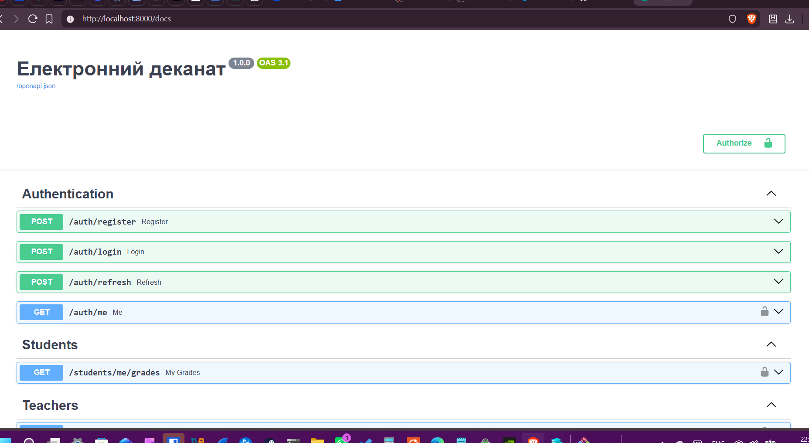
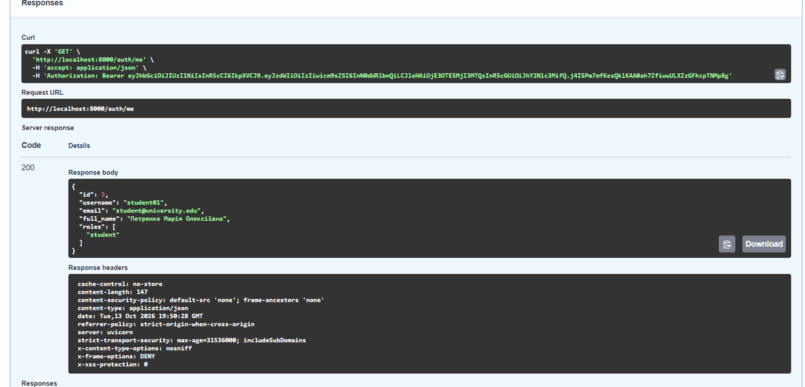
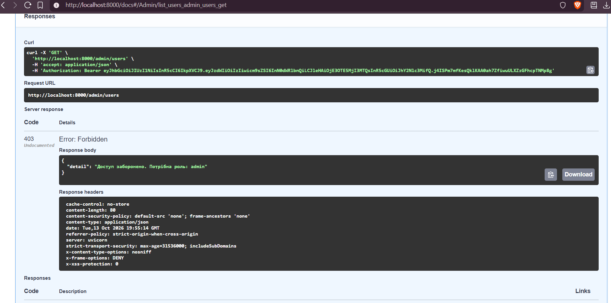
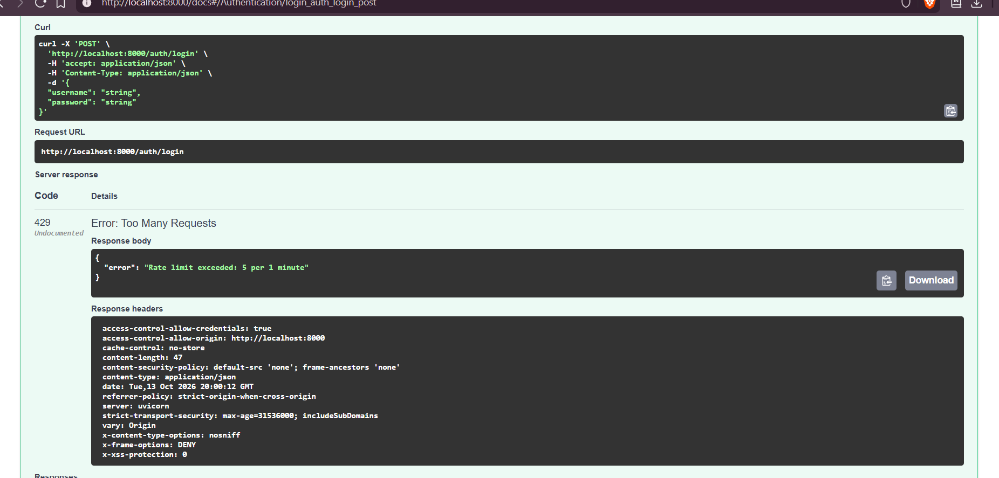
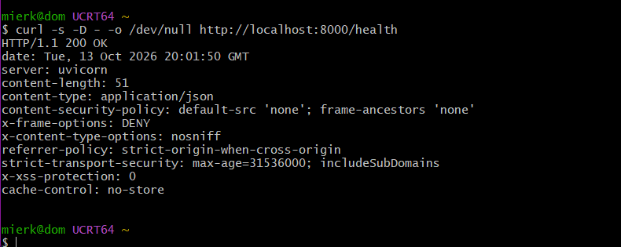

# Заочна практична робота №1: Захищений REST API «Електронний деканат»

* **Дисципліна:** Безпека інформаційних систем
* **Виконав:** студент групи Б2F501ЗОН24 Мєркулов Юрій Валентинович
* **Стек:** FastAPI, Uvicorn, SQLAlchemy 2.0, Alembic, SQLite, Docker Compose, Pydantic, Passlib (bcrypt), python-jose (JWT), bleach, slowapi

Застосунок реалізує багаторівневий захист веб-сервісу (**Defense in Depth**): ізольоване контейнерне середовище, рольову модель доступу (RBAC), стійке хешування паролів за допомогою bcrypt, токенну автентифікацію/авторизацію (JWT Access/Refresh), HTTP Security Headers, CORS, Rate Limiting та санітизацію вхідних даних проти Stored XSS.

---

## 1. Інструкція із запуску (чистий клон)

```bash
# 1. Клонування репозиторію
git clone https://github.com/dom-300/information-security-practice.git
cd information-security-practice

# 2. Налаштування змінних середовища
cp .env.example .env

# 3. Збірка та запуск контейнера
docker compose up -d --build

# 4. Застосування міграцій Alembic
docker compose exec api alembic upgrade head

# 5. Наповнення бази початковими даними (Seed)
docker compose exec api python -m app.seed
```

### Адреси сервісу:
* **API root:** http://localhost:8000/
* **Health check:** http://localhost:8000/health
* **Інтерактивна документація (Swagger UI):** http://localhost:8000/docs
* **Альтернативна документація (ReDoc):** http://localhost:8000/redoc

---

## 2. Ендпоінти системи та матриця доступу

| Метод | Шлях | Призначення | Необхідна роль |
|---|---|---|---|
| GET | `/` | Кореневий ендпоінт | Public |
| GET | `/health` | Стан додатку та кількість таблиць БД | Public |
| POST | `/auth/register` | Реєстрація нового студента (POLP) | Public (ліміт: 10/хв) |
| POST | `/auth/login` | Вхід, видача пари Access/Refresh JWT | Public (ліміт: 5/хв) |
| POST | `/auth/refresh` | Ротація та видача нової пари токенів | Будь-який автентифікований (Refresh token) |
| GET | `/auth/me` | Отримання власного профілю користувача | Будь-який автентифікований (Access token) |
| GET | `/students/me/grades` | Перегляд власних оцінок (тільки своїх) | `student` |
| GET | `/teachers/students/{id}/grades` | Перегляд оцінок конкретного студента | `teacher`, `admin` |
| POST | `/teachers/grades` | Виставлення оцінки студенту (підзвітність) | `teacher`, `admin` |
| GET | `/admin/users` | Перегляд повного списку користувачів і ролей | `admin` |

---

## 3. Тестові облікові записи (Seed Data)

> **Примітка безпеки:** Згідно з рекомендаціями безпеки паролі не публікуються у документації. Тестові облікові записи автоматично створюються скриптом `app/seed.py` з хешуванням алгоритмом bcrypt (`$2b$12$`).

| Логін (username) | Email | Роль | Опис ролі |
|---|---|---|---|
| `admin` | `admin@university.edu` | `admin` | Повний доступ до управління та перегляду користувачів |
| `teacher01` | `teacher@university.edu` | `teacher` | Перегляд та виставлення оцінок студентам |
| `student01` | `student@university.edu` | `student` | Перегляд виключно власних оцінок |

---

## 4. Результати фінальної перевірки (20 сценаріїв)

| № | Сценарій | Запит | Очікуваний результат | Фактичний результат | Статус |
|---|---|---|---|---|---|
| 1 | Health | `GET /health` | 200, tables: 8 | 200, tables: 8 | PASS |
| 2 | Реєстрація (успіх) | `POST /auth/register` | 201, без password_hash | 201, password_hash відсутній | PASS |
| 3 | Дублікат | Той самий username повторно | 409 Conflict | 409 Conflict | PASS |
| 4 | Слабкий пароль | `password: "password"` | 422 Unprocessable Entity | 422 Unprocessable Entity | PASS |
| 5 | XSS в імені | `full_name: "<script>alert(1)</script>"` | 422 Unprocessable Entity | 422 Unprocessable Entity | PASS |
| 6 | Логін admin (успіх) | `POST /auth/login` | 200, access_token + refresh_token | 200, токени згенеровано | PASS |
| 7 | Невірний пароль | `POST /auth/login`, хибний пароль | 401 Unauthorized | 401 Unauthorized | PASS |
| 8 | Без токена | `GET /auth/me` | 401 Unauthorized | 401 Unauthorized | PASS |
| 9 | Підроблений токен | `GET /auth/me`, Bearer abc.def.ghi | 401 Unauthorized | 401 Unauthorized | PASS |
| 10 | Refresh замість access | `GET /auth/me`, Bearer RefreshToken | 401 Unauthorized | 401 Unauthorized | PASS |
| 11 | Оновлення токенів | `POST /auth/refresh` | 200 OK, нова пара токенів | 200 OK, токени оновлено | PASS |
| 12 | Свої оцінки | `GET /students/me/grades` | 200 OK, оцінка 92 | 200 OK, відображено власні оцінки | PASS |
| 13 | Студент → admin | `GET /admin/users` | 403 Forbidden | 403 Forbidden | PASS |
| 14 | Викладач → admin | `GET /admin/users` | 403 Forbidden | 403 Forbidden | PASS |
| 15 | Адмін → admin | `GET /admin/users` | 200 OK, список користувачів | 200 OK, список користувачів | PASS |
| 16 | Оцінка поза діапазоном | `POST /teachers/grades`, grade: 9999 | 422 Unprocessable Entity | 422 Unprocessable Entity | PASS |
| 17 | Stored XSS у коментарі | `POST /teachers/grades` зі script | 201 Created, тег вирізано | 201 Created, санітизовано | PASS |
| 18 | Security Headers | `GET /health` | CSP, X-Frame-Options, nosniff, HSTS | Всі 5 заголовків присутні | PASS |
| 19 | CORS чужий домен | `OPTIONS /auth/login`, Origin: evil.example | 400 Bad Request, без allow-origin | 400 Bad Request | PASS |
| 20 | Rate Limiting | 6x `POST /auth/login` за хвилину | 5 разів 401, 6-й раз 429 | 429 Too Many Requests | PASS |

---

## 5. Моделювання загроз (STRIDE)

| Категорія загроз | Загроза | Контрзахід у проєкті | Що можна покращити |
|---|---|---|---|
| **S** (Spoofing) | Підробка особи або токена автентифікації; запити зі сторонніх сайтів | Підпис токенів алгоритмом HS256 з перевіркою секрету; валідація поля `type`; CORS allow-list | Перехід на асиметричний підпис RS256; зберігання токенів у HttpOnly / SameSite Strict cookie + CSRF-токен |
| **T** (Tampering) | Модифікація вхідних даних; ін'єкції XSS у полях профілю та оцінок | Серверна Pydantic allow-list валідація; санітизація HTML-тегів бібліотекою `bleach` перед записом у БД | Впровадження WAF (Web Application Firewall); перевірка цифрового підпису даних клієнта |
| **R** (Repudiation) | Відмова від авторства виставленої оцінки викладачем | Поле `assigned_by` у таблиці `grades`, прив'язане через Foreign Key до `users.id` | Ведення захищеного Audit Log в окремій системі логування або SIEM (Wazuh / Sentinel) |
| **I** (Information Disclosure) | Перебір дійсних логінів (Username Enumeration); витік паролів; MIME-sniffing | Однакове повідомлення 401 на хибний логін і пароль; хешування bcrypt ($2b$12$); заголовки `nosniff`, `no-store` | Повна обфускація системних трасувань помилок у продакшні |
| **D** (Denial of Service) | Перебір паролів (Brute-force); вичерпання ресурсів бекенду частими запитами | Обмеження частоти запитів через slowapi (Rate Limiting: 5 запитів/хв на `/auth/login`) | Розподілений Rate Limiting на базі Redis; захист від DDoS на рівні Cloudflare |
| **E** (Elevation of Privilege) | Спроба студента отримати доступ до адмін-панелі чи чужих оцінок | Перевірка ролей через `require_role`, актуальний запит ролей напряму з БД при кожному зверненні | Деталізований PBAC (Policy-Based Access Control) на рівні окремих атрибутів записів |

---

## 6. Демонстраційні скріншоти

### 01. Інтерактивна документація Swagger UI


### 02. Успішна автентифікація та виконання GET /auth/me


### 03. Блокування неавторизованого доступу (403 Forbidden)


### 04. Спрацювання Rate Limiting (429 Too Many Requests)


### 05. Заголовки безпеки у відповіді /health



# Безпека

## Інструкція запуску та розгортання

Для початкового розгортання та ініціалізації системи виконайте регламентну послідовність кроків:

1. Створення файлу конфігурації:
   cp .env.example .env

   У файлі .env обов'язково задайте згенеровані криптографічні ключі:
   - JWT_SECRET_KEY: openssl rand -hex 32
   - ENCRYPTION_KEY: python -c "from cryptography.fernet import Fernet; print(Fernet.generate_key().decode())"
   - BLIND_INDEX_KEY: openssl rand -hex 32

2. Генерація TLS-сертифіката для Nginx:
   chmod +x scripts/*.sh
   ./scripts/generate_cert.sh

3. Збірка та запуск захищеного стека:
   docker compose up -d --build

4. Застосування міграцій бази даних:
   docker compose exec api alembic upgrade head

5. Наповнення бази даних тестовими даними:
   docker compose exec api python -m app.seed

Сервіс доступний за захищеною адресою: https://localhost (Nginx примусово перенаправляє HTTP-трафік з порту 80 на 443).

---

